| | |
|---|---|
| **Name** | `<YOUR NAME>` |
| **Register Number** | `<REGISTER NUMBER>` |
| **GitHub Repository** | `https://github.com/<username>/CSA09-<RegisterNumber>-Assignment4` |
| **Java Version** | OpenJDK 21 (the code compiles on JDK 17+) |
| **Submission Date** | `<DATE>` |

**Evidence.** Every result in this report comes from the programs in the repository, run with `bash run_all.sh`. Console output is in `TaskNN/output/*.txt`, raw measurements in `TaskNN/data/*.csv`, graphs in `TaskNN/graphs/` and screenshots in `TaskNN/screenshots/`.

**How the screenshots were produced.** Every screenshot comes from a real AWT/Swing window driven by `java.awt.Robot`: real mouse clicks and real key presses, with no method called directly. Each window was captured with `Robot.createScreenCapture`. A blue caption strip on each image names the requirement or test it proves. The windows ran on an X display with no window manager, which has two consequences:

- The captures show no title bars.
- Minimising is simulated by hiding and showing the window. Like a real restore, this forces a full repaint, which is the behaviour Task 4 tests.

Task 6 is demonstrated offline with an in-process JDBC **test double** (`campus.db.testdouble.FakeCampusDriver`), which runs the DAO's own SQL. The production path is MySQL 8 with Connector/J and `sql/schema.sql`, selected through `db.properties` (see the README).

\newpage

# Task 1 – GUI Design Review: the Fee-Payment Window

## 1.1 Diagnosis

The given class was compiled with only its imports added (`Task01/original/FeeWindow.java`). The compiler stops at the undefined `URL`, `USER` and `PWD` (`output/original_compile.txt`). A copy that defines only those three constants reveals four more errors: unreported `SQLException` ×3 and `InterruptedException` (`output/original_compile_with_constants.txt`).

To observe the design's behaviour, `OriginalBehaviourDemo.java` keeps the same structure: one listener, logic inside it, `==` on the command, SQL built from strings, and `sleep` on the event thread. It adds only enough exception handling to run. A fake "database" records the SQL text it would execute. `Task1Driver` then drives it with real clicks (`output/t1_driver.txt`).

| # | Deficiency | What the user experiences / what goes wrong | Evidence |
|---|---|---|---|
| D1 | **No separation of interface and logic.** Parsing, the database, the bank wait and output all sit inside `actionPerformed`. | Nothing can be tested without a window and a database. Changing the bank or the table means editing the GUI class. | code |
| D2 | **`==` on the action command.** This compares object identity, not text. | It works only while both strings are the same interned literal. An event carrying `new String("Pay")` (from a renamed or localised button, or a programmatic event) is treated as **Clear** and wipes the form. | `"Pay".equals(cmd)=true`, `==` false → form cleared |
| D3 | **No validation.** `Double.parseDouble` runs on raw text. | Typing `45k` or leaving the field empty throws `NumberFormatException` on the event thread. The stack trace goes to the console, and the user sees nothing. Negative or absurd amounts are accepted. | `t1_2_original_invalid_amount.png` |
| D4 | **Database work and `Thread.sleep(3000)` on the event-dispatch thread.** | The window freezes for about 3 s. It does not repaint, accept typing or respond to clicks, and impatient users click Pay again. **Measured:** a task posted to the EDT after clicking Pay waited **2,765 ms**. | `t1_1_original_after_pay.png` |
| D5 | **No feedback to the user.** The only output is `System.out.println("Paid")`. | The user never learns whether the payment succeeded, failed or is still running. | `t1_1…png` |
| D6 | **The Receipt button falls into `else`.** | Clicking **Receipt clears the form**, and no receipt can ever be shown. | `t1_3_original_receipt_clears.png` |
| D7 | **SQL built by concatenation (`createStatement`).** | SQL injection. The register number `1'); DROP TABLE fees; --` produced `INSERT INTO fees VALUES('1'); DROP TABLE fees; --',100.0)`. Quotes in names also break the statement. | driver output |
| D8 | **Window and connection are never closed.** There is no `WindowListener`, and the `Connection` and `Statement` are never closed. | The close button does nothing (`displayable = true` after WINDOW_CLOSING). Each payment leaks a connection until the server refuses new ones. | driver output |
| D9 | **Unhandled checked exceptions.** `SQLException` and `InterruptedException` cannot be thrown from `actionPerformed`. | The program does not compile, and a "fix" that adds `throws` is impossible. A naive `catch {}` would hide failures. | compiler output |
| D10 | **`double` for money; no transaction or receipt record.** | Rounding errors (`0.1 + 0.2 ≠ 0.3`). A bank success followed by a failed INSERT loses the payment record. | – |

## 1.2 Repaired design

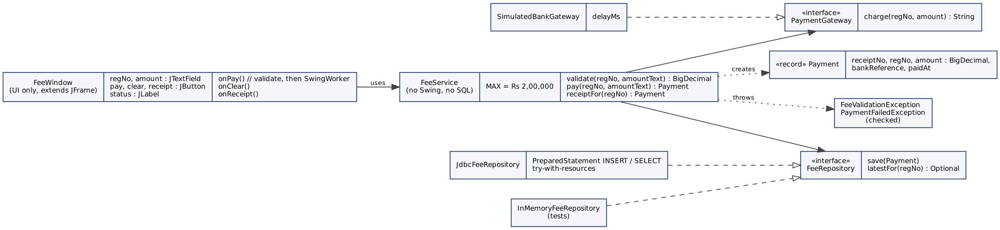{width=100%}

In the redesign (`Task01/src/fees/`):

- **`FeeWindow`** only collects input and shows results.
- **`FeeService`** holds every rule.
- **`PaymentGateway`** and **`FeeRepository`** are interfaces, so tests can substitute a bank with no delay and an in-memory store.
- **`JdbcFeeRepository`** uses `PreparedStatement` and try-with-resources.
- Money is a `BigDecimal`.
- **`FeeValidationException`** carries a message the user can act on. **`PaymentFailedException`** keeps the technical cause.

The rewritten event handling gives each button its own listener:

```java
pay.addActionListener(e -> onPay());          // one listener per button - no string comparison
clear.addActionListener(e -> onClear());
receipt.addActionListener(e -> onReceipt());  // now shows the receipt
setDefaultCloseOperation(DISPOSE_ON_CLOSE);

void onPay() {
    try { service.validate(regNo.getText(), amount.getText()); }   // fast, on the EDT
    catch (FeeValidationException ex) { show(ex.getMessage(), true); return; }
    pay.setEnabled(false);                                         // no double payment
    status.setText("Processing payment - waiting for bank confirmation...");
    String r = regNo.getText(), a = amount.getText();
    new SwingWorker<Payment, Void>() {
        protected Payment doInBackground() throws Exception { return service.pay(r, a); } // worker thread
        protected void done() {                                                           // back on the EDT
            pay.setEnabled(true);
            try { Payment p = get(); show("Paid Rs " + p.amount() + " - receipt " + p.receiptNo(), false); }
            catch (ExecutionException ex) { show(ex.getCause().getMessage(), true); }
            catch (InterruptedException ex) { Thread.currentThread().interrupt(); }
        }
    }.execute();
}
```

| Test (real clicks, `t1_driver.txt`) | Result | Screenshot |
|---|---|---|
| Pay with an empty form | "Enter the register number." | `t1_4_redesign_empty.png` |
| Amount `45k` | "Amount must be a number…", nothing sent to the bank | `t1_5_redesign_bad_amount.png` |
| Valid payment, during the 3 s bank wait | EDT latency **0 ms**; Pay disabled; progress message shown | `t1_6_redesign_processing.png` |
| After the worker finishes | "Paid Rs 45000.50 – receipt RCPT-24001 (bank ref BNK880101)" | `t1_7_redesign_paid.png` |
| Receipt button | Receipt dialog | `t1_8_redesign_receipt.png` |
| Close button | Window disposed (`displayable=false`) | – |

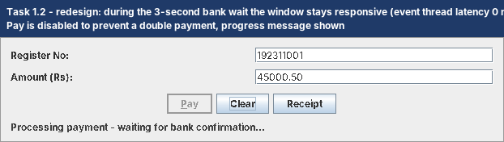{width=70%}

**FeeService tests** run with no window, no database and no 3 s wait (`output/t1_feeservice_tests.txt`). **12/12 pass**:

- a valid payment;
- empty register number; letters in the amount; negative amount; 3 decimal places; over the limit;
- SQL text in the register number (rejected by validation, and the value would be bound as a parameter anyway);
- receipt after payment; receipt when there is no payment;
- bank decline;
- nothing stored for rejected payments;
- exact `BigDecimal` arithmetic.

## 1.3 Design defence (99 words)

> All rules now live in `FeeService`, which has no Swing or SQL types, so they are tested by plain method calls in milliseconds. The bank and the database sit behind interfaces, so tests substitute an instant bank and an in-memory store. The window holds no logic: each button has its own small listener, so adding or renaming a button touches one line. Slow work runs in a `SwingWorker`, so the window stays responsive and gives clear feedback. Prepared statements and try-with-resources remove injection and connection leaks. A change to one concern (UI, rules, storage) no longer ripples through the others.

## Alternative concept – one listener object per button (or a Swing `Action`)

With one listener per button (`pay.addActionListener(e -> onPay())`, as above) or one `Action` per command, the toolkit calls the right handler directly. With the given design, a shared listener compares the action command against up to k strings.

`DispatchBenchmark` (`data/t1_dispatch.csv`) measures 2 million events per k, with each event targeting a random button:

| k buttons | if-else chain (ns/event) | own listener (ns/event) | memory of k listeners |
|---|---|---|---|
| 3 | 17.5 | 3.6 | 872 B |
| 10 | 49.1 | 3.5 | 1,008 B |
| 50 | 156.2 | 3.5 | 1,808 B |
| 100 | 204.9 | 1.8 | 2,808 B |

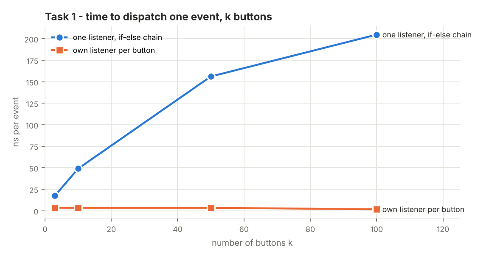{width=80%}

- **Time.** The chain makes (k+1)/2 `equals` comparisons on average, which is **O(k)** per event. The direct listener is **O(1)**: one virtual call regardless of k.
- **Space.** One shared listener is O(1). k listeners are **O(k)**. The measured slope is (2,808 − 1,008)/90 ≈ **20 bytes per listener**: a 16-byte capturing lambda object plus a 4-byte array reference. The roughly 800 B constant is measurement overhead.
- **Verdict.** Even at k = 100 that is under 3 KB, while every click on the chain costs 100× more time. More importantly, the chain is fragile (D2), and adding a button means editing it. Per-button listeners, or `Action`s when several controls trigger the same command (Task 5), are the better design.

\newpage

# Task 2 – Hospital Outpatient Appointment Desk

Implementation:

- `Task02/AppointmentDesk.java` (Swing) is the UI.
- `AppointmentService.java` holds the logic. It loads `input/doctors.csv` **once** into a `Map<String, List<Doctor>>`, validates, books, and tracks booked slots.

## 2.1 Event model

| Event source | Event object | Listener interface (method) | Action taken |
|---|---|---|---|
| `department` JComboBox | `ItemEvent` (DESELECTED old, SELECTED new) | `ItemListener.itemStateChanged` | On SELECTED: `refreshDoctors()` – clear the doctor list and slots, fill the list from the map |
| `doctors` JList | `ListSelectionEvent` | `ListSelectionListener.valueChanged` | Ignore while `getValueIsAdjusting()`; `refreshSlots()` with the doctor's free slots |
| `slot` JComboBox | `ActionEvent` | `ActionListener.actionPerformed` | Remember the chosen slot; mark a booking as in progress |
| `patientId` document | `DocumentEvent` | `DocumentListener.insertUpdate/removeUpdate` | Mark a booking as in progress (data typed) |
| `book` JButton | `ActionEvent` | `ActionListener.actionPerformed` | `doBook()`: the service validates and books; show the confirmation or error |
| `clear` JButton | `ActionEvent` | `ActionListener.actionPerformed` | Reset the form; no booking in progress |
| JFrame | `WindowEvent` WINDOW_OPENED / ACTIVATED / DEACTIVATED | `WindowListener.windowOpened` … | Trace only |
| JFrame close button | `WindowEvent` WINDOW_CLOSING | `WindowListener.windowClosing` (with `DO_NOTHING_ON_CLOSE`) | If a booking is in progress, show a `JOptionPane` YES/NO dialog. On YES `dispose()`; on NO stay open |
| JFrame after `dispose()` | `WindowEvent` WINDOW_CLOSED | `WindowListener.windowClosed` | Trace (release resources) |

## 2.2 Component hierarchy

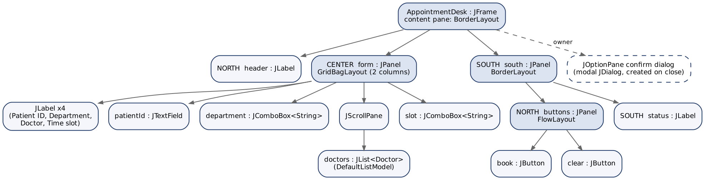{width=88%}

## 2.3 Handler pseudocode

```text
ALGORITHM RefreshDoctors(event)                     // ItemListener on department
    IF event.stateChange ≠ SELECTED THEN RETURN      // ignore the DESELECTED half of the pair
    doctorModel.clear(); slotBox.removeAllItems()
    dept <- department.selectedItem
    list <- doctorsByDept.getOrDefault(dept, empty)  // O(1) map lookup, no database
    FOR EACH d IN list DO doctorModel.add(d) END FOR
    bookingInProgress <- true
END

ALGORITHM ValidateAndBook()                         // ActionListener on Book
    id <- trim(upper(patientId.text))
    IF id is empty                    THEN Show("Enter the patient ID.");  RETURN
    IF id does not match P + 6 digits THEN Show("Patient ID must be P followed by 6 digits"); RETURN
    IF department index = 0           THEN Show("Select a department."); RETURN
    IF doctor = null                  THEN Show("Select a doctor."); RETURN
    IF doctor.department ≠ department THEN Show("Doctor does not belong to ..."); RETURN
    IF slot = null                    THEN Show("Select a time slot."); RETURN
    key <- doctor.id + "@" + slot
    IF NOT booked.add(key)            THEN Show(slot + " is already booked."); RETURN
    Show("Booked APT-n: id with doctor at slot")          // green confirmation
    RefreshSlots()                                        // booked slot disappears
    bookingInProgress <- false
END
```

| Test (real input) | Result | Screenshot |
|---|---|---|
| Window opened | Departments loaded, doctor list empty | `t2_1_opened.png` |
| Department → Cardiology | 3 Cardiology doctors | `t2_2_department_cardiology.png` |
| Department → Paediatrics | List replaced by the Paediatrics doctors | `t2_3_department_paediatrics.png` |
| P104233, Dr. Priya Natarajan, 09:15, Book | "Booked APT-5001 …"; slots go from 4 to 3 free | `t2_4_booked.png` |
| Patient ID `12345` | "Patient ID must be P followed by 6 digits" | `t2_5_invalid_id.png` |
| No department | "Select a department." | `t2_6_no_department.png` |
| Close with data entered | Confirmation dialog | `t2_7_close_confirm.png` |
| Answer **No** | Desk stays open with its data | `t2_8_after_no.png` |
| Close again, answer **Yes** | `windowClosed`, `displayable=false` | trace |

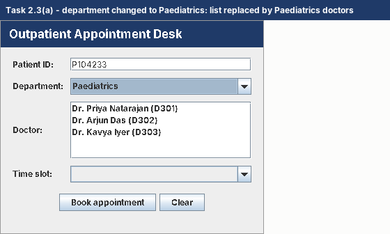{width=55%} 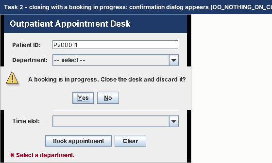{width=44%}

## 2.4 Event trace (open → close)

The order below is from `output/t2_event_trace.txt`, where every listener method writes a timestamped line:

```text
constructor: building components  -> pack()          (frame displayable, not yet visible)
windowActivated                                       (setVisible(true))
windowOpened                                          (first time only)
itemStateChanged(DESELECTED "-- select --"), itemStateChanged(SELECTED Cardiology) -> refreshDoctors()
itemStateChanged(DESELECTED Cardiology),     itemStateChanged(SELECTED Paediatrics) -> refreshDoctors()
valueChanged(doctor list) -> refreshSlots();  actionPerformed(slot) 09:00 ... 09:15
actionPerformed(Book) -> book() CONFIRMED -> refreshSlots()
actionPerformed(Book) -> ERROR (invalid ID);  actionPerformed(Clear) ...; actionPerformed(Book) -> ERROR
windowClosing (booking in progress = true) -> windowDeactivated (modal dialog takes focus) -> answered NO
windowClosing -> answered YES -> dispose() -> windowClosed
```

`windowOpened` and `windowActivated` can arrive in either order, depending on the platform. In this run, activation came first. Without a window manager the frame does not receive `windowActivated` again after the dialog closes; on a desktop it would.

**Comparison with an applet.**

- `init()` corresponds to the constructor (build the components, load the map).
- `start()` corresponds to `setVisible(true)` and `windowOpened`/`windowActivated`.
- `paint()` is called by the toolkit whenever the window needs redrawing. Swing components do this for us.
- `stop()` corresponds to `windowDeactivated`/`windowIconified`.
- `destroy()` corresponds to `windowClosing` → `dispose()` → `windowClosed`.

The difference is who is in control. The **browser** calls an applet's life-cycle methods, and the applet cannot refuse to be destroyed. A frame application controls its own life cycle, so it can veto closing, as the confirmation dialog does here. (The Applet API has been deprecated for removal since Java 17, and browsers no longer run applets.)

## Alternative concept – fetch doctors on every department change

**Alternative design:** in `itemStateChanged`, run `SELECT doctor_id, name FROM doctors WHERE dept = ?` (in a `SwingWorker`, so the EDT is not blocked), then fill the list in `done()`.

`DoctorLookupBenchmark` (`data/t2_lookup.csv`) compares three versions. "Fetch" re-reads and scans the CSV file, like a query without an index. A third version adds a 2 ms simulated database round trip.

| d depts | m doctors | Map lookup (µs/change) | fetch (µs/change) | fetch + 2 ms RTT (µs) | Map memory |
|---|---|---|---|---|---|
| 5 | 11 | 2.3 | 127.5 | 2,379 | 3.6 KB |
| 20 | 200 | 0.6 | 155.6 | 2,326 | 36.5 KB |
| 50 | 2,000 | 0.3 | 341.4 | 2,537 | 357.5 KB |
| 100 | 10,000 | 0.4 | 1,786.0 | 4,218 | 1,769.7 KB |

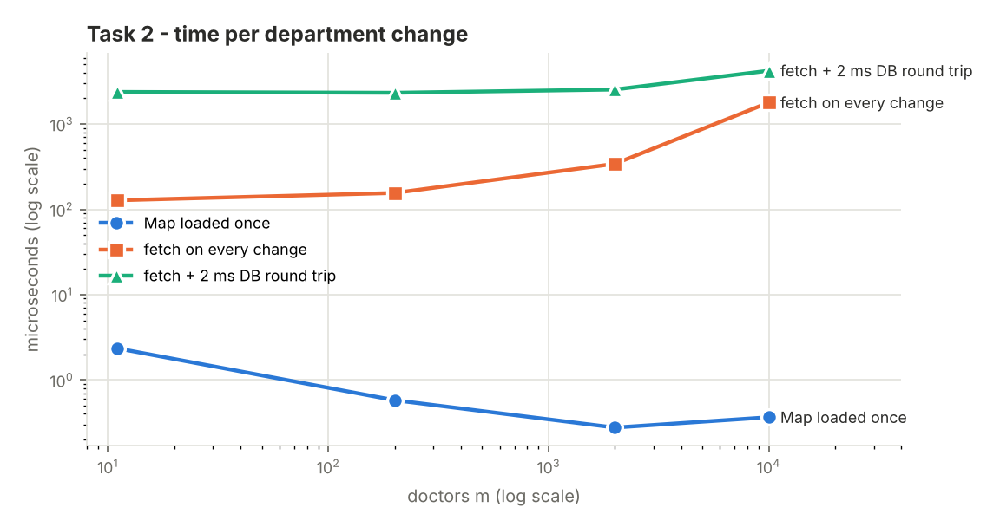{width=78%}

- **Map loaded once.** Start-up costs O(d·m) once, and each change is an **O(1)** hash lookup plus O(m) to fill the list model. Memory is **O(d·m)** doctor objects kept for the whole session: about 180 B per doctor, or 1.7 MB for 10,000 doctors.
- **Fetch per change.** Each change costs a round trip plus O(m) to transfer and decode the department's rows. With an index on `dept` the scan is O(log N + m); without one it is O(N). Memory is only **O(m)** for the current department.
- **Measured.** Even with a local file the map is 50–4,000× faster, and with a database round trip every change costs over 2 ms against under 3 µs.
- **Verdict.** For a hospital's doctor list, which is small and changes rarely, the Map is the right choice. Fetching wins only when the data is very large or must always be current, for example live slot availability shared by several desks. A hybrid works well: keep the map of doctors and fetch only the slots.

\newpage

# Task 3 – Campus Library Search Screen

## 3.1 Layout managers and justification

| Container | Layout | Why (with respect to resizing) |
|---|---|---|
| Frame | **BorderLayout** | CENTER takes **all** extra width and height. NORTH and SOUTH keep their preferred height and only stretch horizontally. Results go in CENTER; the search and button rows go NORTH/SOUTH. |
| `top` panel (NORTH) | **BorderLayout** | Stacks two rows, title (NORTH) and search row (SOUTH), each at its preferred height. |
| `searchRow` | **FlowLayout(LEFT)** | Keeps the text field, Choice and Search button at their **preferred size**, left-aligned. Extra width becomes empty space, so the controls never stretch. |
| `results` (List) in CENTER | – | Is the CENTER component, so it is the only region that grows. |
| `bottom` panel (SOUTH) | **BorderLayout** | Stacks the button row and the status label. |
| `buttonRow` | **FlowLayout(CENTER)** | Prev/Next/Reserve keep their size and stay centred. |
| `status` Label | – | Stretches horizontally only, which suits a message line. |

The other options were rejected:

- **GridLayout** makes every cell the same size and stretches the buttons, which breaks the requirement.
- **CardLayout** switches between whole panels, which this screen does not need.

## 3.2 Nested containers

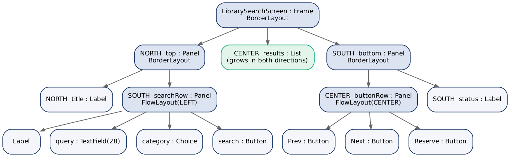{width=82%}

## 3.3 Implementation and interaction tests

Code:

- `Task03/LibrarySearchScreen.java` contains only components and handlers.
- `LibraryCatalog.java` does search, paging (8 per page) and reservation over `input/catalogue.csv` (60 items).

| Test (real typing and clicks) | Result | Screenshot |
|---|---|---|
| Type `java`, click Search | 12 items found; 8 shown | `t3_1_search_java.png` |
| Select the 2nd row, click Reserve | "Reserved L0005 'Java: The Complete Reference (Ed. 2)'" | `t3_2_reserve.png` |
| Empty search (all 60), click Next | "Page 2 of 8"; Prev enabled | `t3_3_paging.png` |

## 3.4 Resizing test

Bounds were read from the live components after `setSize` (`data/t3_resize_bounds.csv`):

| Region | 520 × 340 | 800 × 520 | 1100 × 720 | Behaved as designed? |
|---|---|---|---|---|
| Title | 520 × 29 | 800 × 29 | 1100 × 29 | ✔ height fixed |
| Search row | 520 × 43 | 800 × 43 | 1100 × 43 | ✔ height fixed |
| Text field | 234 × 31 | 234 × 31 | 234 × 31 | ✔ same size |
| Search button | 55 × 23 at x=424 | 55 × 23 at x=424 | 55 × 23 at x=424 | ✔ same size and place |
| **Results area** | **520 × 212** | **800 × 392** | **1100 × 592** | ✔ **grows in both directions** |
| Button row | 520 × 35 | 800 × 35 | 1100 × 35 | ✔ height fixed |
| Next button | 41 × 23 at x=229 | 41 × 23 at x=369 | 41 × 23 at x=519 | ✔ same size, stays centred |
| Status | 520 × 21 | 800 × 21 | 1100 × 21 | ✔ height fixed |

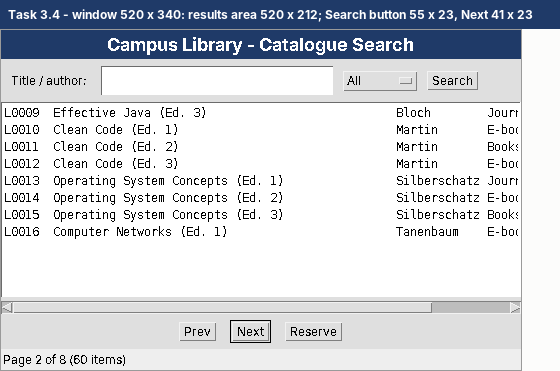{width=48%} 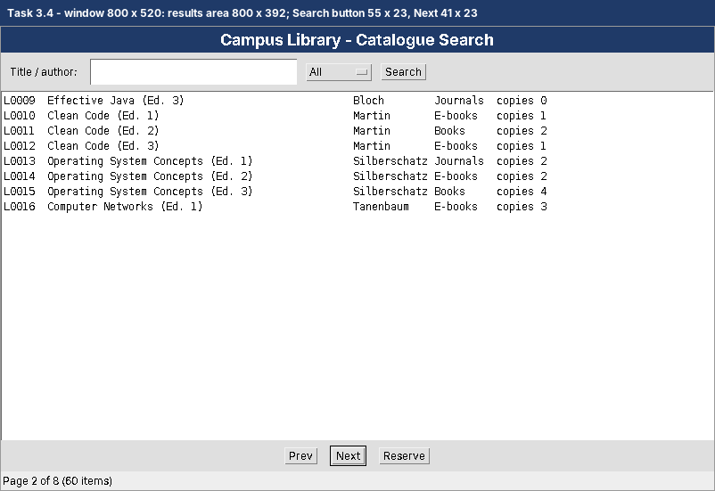{width=51%}

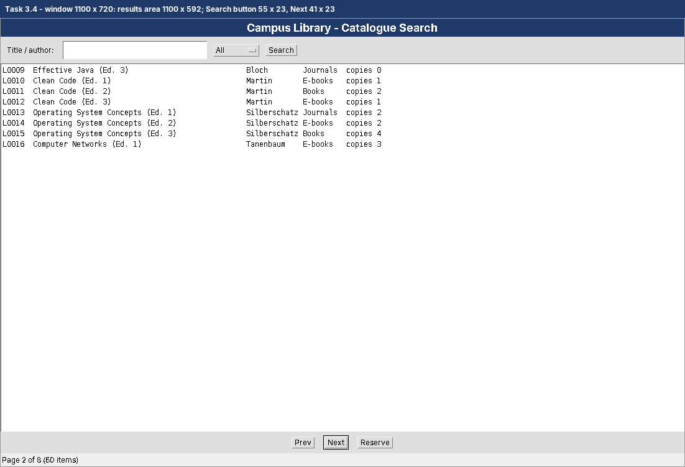{width=75%}

## Alternative concept – GridBagLayout or absolute positioning

**(a) GridBagLayout** (`LibraryAlternatives.gridBag()`) uses **one** panel with 5 rows. The results row has `weighty = 1` and `fill = BOTH`; the other rows have `weighty = 0`, and a filler cell with `weightx = 1` keeps the search controls left-aligned. Its resizing matches the nested design (`t3_alt_gridbag_1100x720.png`), but the constraints are verbose and harder to read. The buttons still need one small panel.

**(b) `setLayout(null)` + `setBounds`** (`LibraryAlternatives.absolute()`) places every component by hand for 640 × 420. When the window is enlarged nothing grows, leaving empty space. When it is shrunk, the Search button, list, buttons and status bar are **cut off**. Fonts, look-and-feel and DPI changes also break it.

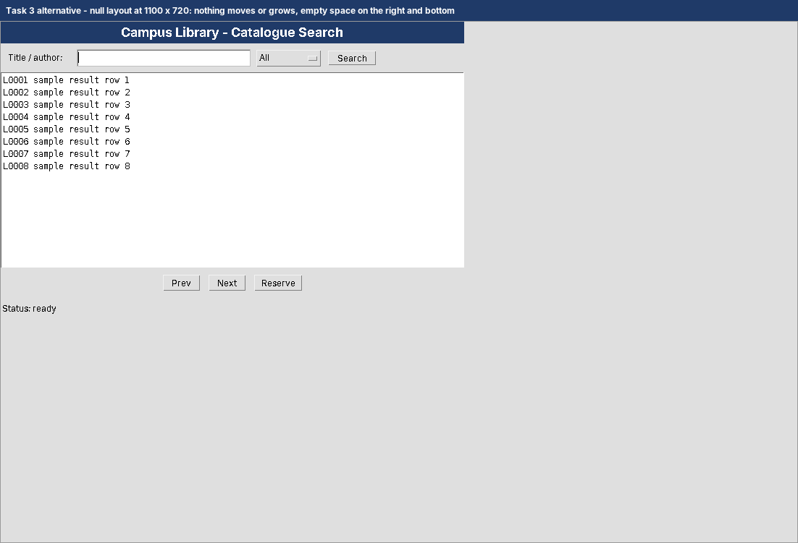{width=56%} 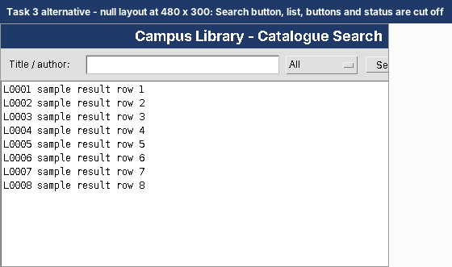{width=43%}

Full invalidate + validate at 800 × 520, mean of 2,000 runs (`data/t3_layout_time.csv`):

| Design | Containers (space) | Leaf components | Layout time |
|---|---|---|---|
| Nested Border/Flow panels | 5 (Frame + 4 Panels) | 10 | 67 µs |
| Single GridBagLayout panel | 3 (Frame + 2 Panels) | 11 | 41 µs |
| null layout | 1 (Frame) | 10 | 20 µs |

- **Complexity.** All three are **O(c)** per layout for c components. The nested design visits each container's children once and recurses, so it is O(c + p) for p panels. GridBagLayout builds row and column tables, so it is O(c + rows + columns). Absolute positioning does no computation, only the `setBounds` calls already stored.
- **Space.** The nested design needs O(p) extra Panel objects (4 here). GridBag stores a constraints object per component. Null layout needs neither.
- **Verdict.** The differences are tens of microseconds, and layout runs only on resize, so they are irrelevant to the user. **Correct resizing is what matters**, and null layout fails that requirement. The nested Border/Flow design is chosen because it is the simplest to read and justify; GridBag is a valid single-panel alternative.

\newpage

# Task 4 – Event-Handling Forensics: the Draw Pad

## 4.1 Locating the defect

- **Why the click is never handled.** `MouseAdapter` declares `mouseClicked(MouseEvent)`. The anonymous class declares **`mouseclicked`**, lowercase c. Java is case-sensitive, so this is a *new* method that nothing ever calls. The adapter's empty `mouseClicked` runs instead, so the click is silently ignored.
- **Why the label never changes.** Even if the method ran, it only does `count++`. It never calls `status.setText(...)`, so the label would stay "Clicks: 0".
- **Evidence.** `DrawPadOriginal.java` is the given code with imports and `main`. After **5 real clicks** the count field is 0 and the label reads 'Clicks: 0' (`t4_1_original_after_5_clicks.png`).

## 4.2 Failing interaction (after the first fix)

`DrawPadGetGraphics.java` has the name fixed and still draws with `getGraphics()`. The interaction that reveals the problem has four steps:

1. Click 5 times. The dots appear and the label reads 'Clicks: 5'.
2. Minimise the window.
3. Restore it.
4. **All the dots are gone**, while the label still says 5.

**Why.** `getGraphics()` paints directly on the screen pixels once; nothing remembers the dots. When the window is restored, uncovered or resized, the toolkit asks the frame to repaint itself through `paint(Graphics)`. `Frame.paint` only clears the background and draws the child components, so the dots are lost.

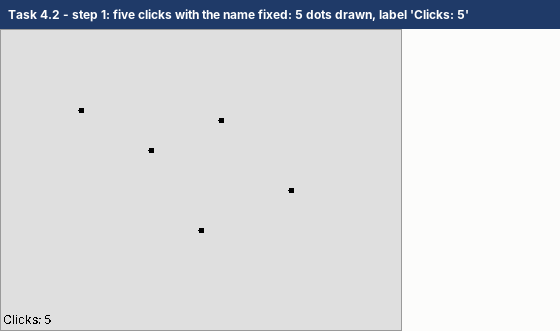{width=49%} 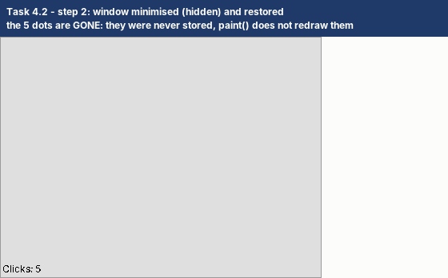{width=49%}

## 4.3 Repaired program (Complete the Code – `Task04/DrawPad.java`)

```java
addMouseListener(new MouseAdapter() {
    @Override public void mouseClicked(MouseEvent e) {          // TODO 1
        points.add(e.getPoint());
        status.setText("Clicks: " + points.size());
        repaint();
    }
});
...
@Override public void paint(Graphics g) {                        // TODO 2
    for (Point p : points) g.fillOval(p.x - 3, p.y - 3, 6, 6);   // 6 x 6 circle centred on the point
}
```

After 5 clicks the label reads 'Clicks: 5' with 5 stored points. After minimise and restore **all 5 dots are still there**, and they also survive a resize, because `paint()` redraws them from the list every time.

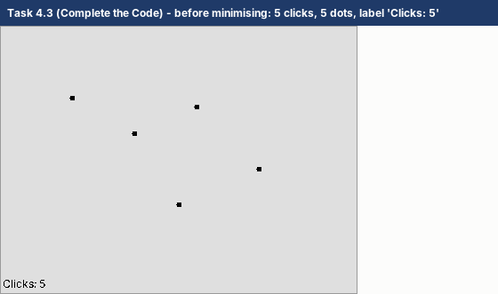{width=49%} 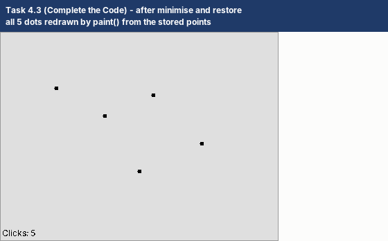{width=49%}

## 4.4 Preventing recurrence with `@Override`

`@Override` asks the compiler to check that the method really overrides a supertype method. With the misspelling (`compile_error_demo/DrawPad.java`):

```text
compile_error_demo/DrawPad.java:25: error: method does not override or implement a method from a supertype
            @Override public void mouseclicked(MouseEvent e) {     // misspelled ON PURPOSE
            ^
1 error
```

Without the annotation, the same misspelling compiles **with no error** (`output/compile_no_override.txt`). The defect then only shows up at run time, as "nothing happens". The rule is to always put `@Override` on listener and adapter methods. Where possible, use a lambda on a single-method interface, because a lambda cannot misname the method.

## Alternative concept – off-screen BufferedImage

`DrawPadBuffered.java` draws each dot once onto an image of the window's size in `mouseClicked`. Its `paint` contains only `g.drawImage(canvas, 0, 0, null)`. The dots also survive minimise and restore (`t4_alt_buffered_after_restore.png`).

`RepaintBenchmark` (`data/t4_repaint.csv`) measures milliseconds per repaint of a 400 × 300 area (median of 5):

| clicks n | stored points | BufferedImage copy | points memory | image memory |
|---|---|---|---|---|
| 10 | 0.07 ms | 0.13 ms | 0.3 KB | 469 KB |
| 100 | 0.46 ms | 0.22 ms | 2.7 KB | 469 KB |
| 1,000 | 2.95 ms | 0.41 ms | 27 KB | 469 KB |
| 10,000 | 16.1 ms | 0.41 ms | 273 KB | 469 KB |
| 100,000 | 205.2 ms | 0.43 ms | 2,734 KB | 469 KB |

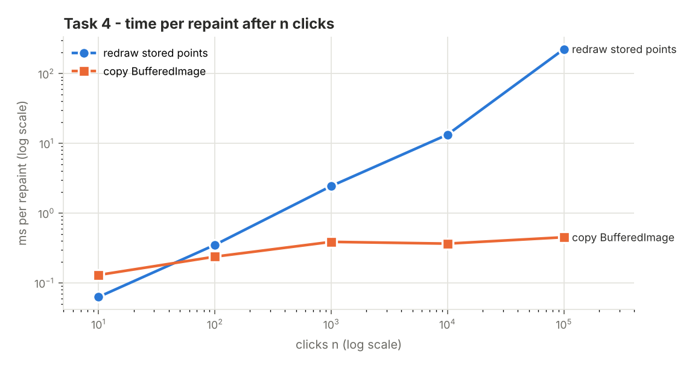{width=78%}

- **Time.** Stored points cost **O(n)** per repaint, and at 100,000 clicks a repaint takes 205 ms, which is visible lag. The image copy is **O(w·h)**, independent of n; drawing a new dot is O(1).
- **Space.** Points use **O(n)** memory, about 28 B per Point. The image uses **O(w·h)**: 400 × 300 × 4 B ≈ 469 KB, even with no dots at all. The two cross over at about 17,000 clicks.
- **Trade-off.** The image must be recreated (and the dots redrawn, or lost) when the window grows. The point list also keeps the data, which allows undo, saving and scaling.
- **Verdict.** For a drawing pad with modest n the point list is simpler and more flexible. For thousands of marks, a buffered image (or a list plus a cached image) is the right design.

\newpage

# Task 5 – Same Screen, Different Event-Handling Styles

## 5.1 Four implementations (`Task05/styles/v1/`)

The four classes are identical except for how the Convert action is attached:

- **(a)** `ConverterImplements` — `implements ActionListener` with `addActionListener(this)` and an `if (e.getSource() == convert)` check.
- **(b)** `ConverterNamedInner` — a `private class ConvertHandler implements ActionListener`.
- **(c)** `ConverterAnonymous` — `new ActionListener() { ... }` passed inline.
- **(d)** `ConverterLambda` — `convert.addActionListener(e -> convert())`.

All four use `DO_NOTHING_ON_CLOSE` plus a `WindowAdapter` whose `windowClosing` calls `dispose()`.

| Test, each style (`t5_v1.txt`) | Result |
|---|---|
| 1000, USD, Convert | 12.00 USD |
| `abc`, Convert | Invalid amount |
| `abc`, Enter (not wired in v1) | Label unchanged – Enter does nothing yet |
| WINDOW_CLOSING | `WindowAdapter` disposes the frame (`displayable=false`) |

{width=49%} {width=49%}

## 5.2 Changed requirement: Enter key + result in a dialog (`styles/v2/`)

Lines changed, measured with `diff` (`output/t5_change_effort.txt`):

| Style | Added | Removed | What had to change |
|---|---|---|---|
| (a) implements | +5 | −3 | Register `this` on `amount` too; widen the `getSource()` test to two sources; two `setText` → `JOptionPane` |
| (b) named inner | +6 | −3 | Create the handler once in a variable and register it twice; dialogs |
| (c) anonymous | +7 | −4 | **Restructure**: the inline object must be stored in a variable to be shared, so the call that wrapped it is rewritten |
| (d) lambda | +4 | −2 | One extra `amount.addActionListener(onConvert)`; dialogs in `convert()` |

All four v2 versions were tested: 2500 + Enter shows a dialog "2500.00 INR = 30.00 USD", and `abc` + Convert shows an error dialog "Invalid amount" (`t5_v2_*`).

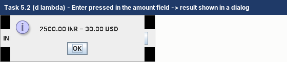{width=60%}

## 5.3 Comparison

| Criterion | (a) frame implements | (b) named inner | (c) anonymous inner | (d) lambda |
|---|---|---|---|---|
| Readability | Poor once there is more than one source: an `if/else` on `getSource()` | Good; the name documents intent | Verbose boilerplate inline | Best: handler is one line, logic in a named method |
| Access to the frame's fields | Direct (it *is* the frame) | Direct via `Outer.this` | Direct; effectively-final locals | Direct; effectively-final locals |
| Reuse of the handler | One object for everything, but dispatch by `if` | **Easy**: `new ConvertHandler()` anywhere, even from another class in the package | Hard unless stored in a variable | Easy if stored or written as `this::convert` |
| Ease of change (5.2) | Medium (+5/−3); the `if` grows with every source | Medium (+6/−3) | Worst (+7/−4, restructure) | **Best** (+4/−2) |
| Public API impact | Exposes `actionPerformed` publicly | None | None | None |

**Large applications.** Use **lambdas or method references that delegate to named methods**, and for commands with several triggers use **`Action` objects**. Business logic should go to a service class, as in Task 6. This keeps the UI wiring to one line per trigger, avoids `getSource()` chains, and lets one command carry its own enabled state, text and shortcut.

## Complete the Code (`Task05/Converter.java`)

```java
// TODO 1
ActionListener onConvert = e -> convert();     // ONE lambda object ...
convertButton.addActionListener(onConvert);     // ... for the button
amount.addActionListener(onConvert);            // ... and for Enter in the amount field
// TODO 2
String currency = (String) target.getSelectedItem();
try {
    double inr = Double.parseDouble(amount.getText().trim());
    result.setText(String.format("%.2f %s", inr * rate(currency), currency));
} catch (NumberFormatException e) {
    result.setText("Invalid amount");
}
```

| Run (`output/t5_complete.txt`) | Result | Screenshot |
|---|---|---|
| 1000, USD, Convert button | **12.00 USD** | `t5_complete_valid_usd.png` |
| 2500, EUR, Enter key (same listener) | **27.50 EUR** | `t5_complete_valid_eur_enter.png` |
| `12a`, Convert | **Invalid amount** | `t5_complete_invalid.png` |

{width=49%} {width=49%}

The run also revealed a layout issue. `pack()` sizes the window while the result label holds `" "`. When the result appears, the FlowLayout wraps it to a second row that is outside the packed window and therefore invisible. The driver widens the window before showing it. In a real program, give the label a preferred width or use a layout with a fixed result cell.

## Alternative concept – method reference or one shared `Action`

**Method reference.** `convertButton.addActionListener(this::convert)` needs `convert(ActionEvent)` or a wrapper. Each evaluation of `this::convert` creates a **new** listener object. The driver showed that writing it at 2 registrations makes 2 objects, while storing it once in a variable makes 1. It behaves like style (d).

**Shared Action.** `ConverterSharedAction.java` defines one `AbstractAction("Convert")` with a Ctrl+Enter accelerator, used by:

- `new JButton(action)`;
- `new JMenuItem(action)`;
- `amount.setAction(action)` for the Enter key;
- a root-pane `InputMap`/`ActionMap` binding for Ctrl+Enter anywhere.

The driver confirmed that all triggers hold **the same object**: Ctrl+Enter gives '12.00 USD' (`t5_action_ctrl_enter.png`). Calling `action.setEnabled(false)` disables the button and the menu item together (`t5_action_disabled.png`).

| Approach | Listener objects for t triggers | Work to add a new trigger |
|---|---|---|
| (a) implements | 1 (the frame), but O(t) `if` branches | register + extend the `getSource()` test |
| (b) named inner | 1 if shared, t if `new` each time | 1 line (`addActionListener(handler)`) |
| (c) anonymous | t, unless refactored into a variable | refactor, then 1 line |
| (d) lambda / method reference | 1 if stored, t if written at each call site | 1 line |
| **Shared Action** | **1**, plus shared text, icon, shortcut and enabled state | **1 line** (`new JMenuItem(action)`); the text and shortcut come automatically |

Space is O(1) for a shared object against O(t) for one object per trigger, about 16–20 B each, so memory is not the deciding factor. The **Action** wins on consistency: one place controls the command's text, shortcut and enabled state.

\newpage

# Task 6 – Design Challenge: Campus Event Registration

## Stage 1 – Interpreting the problem

**Users**

- *Student*: registers for an event, possibly at a desk run by a committee member.
- *Committee member*: views, filters and exports registrations.

**Screens**

1. Register form.
2. Registrations list (table, filter, paging, export).

Plus dialogs: duplicate warning, database error, file chooser, About.

**Data** (MySQL `campus_events`, `sql/schema.sql`)

- `events(event_id, name, event_date, venue, capacity)`.
- `registrations(reg_id, reg_no, student_name, email, dept, year, event_id → events, registered_at)` with **UNIQUE (reg_no, event_id)** and an index on `(event_id, reg_id)`.

**Requirements as testable statements**

| ID | Requirement (testable) | Verified by |
|---|---|---|
| R1 | Register number must be exactly 9 digits, otherwise the message "Register number must be exactly 9 digits." | T5, T10, TC2 |
| R2 | Name: letters, spaces and dots, 2–60 characters | T6, TC2 |
| R3 | E-mail must match `local@domain.tld` | T7, TC2 |
| R4–R6 | Department, year (1–4) and event must be selected; **every** invalid field is reported and outlined | T8, T9, TC2 |
| R7 | A student cannot register twice for the same event (service check **and** database UNIQUE key); a different event is allowed | T3, T4, T12, TC3 |
| R8 | A registration is refused when the event has reached its capacity | T11, TC4 |
| R9 | The window stays responsive during database work: event-thread delay < 50 ms while loading | TC5 (1 ms), benchmark |
| R10 | The table shows 20 rows per page with "Page x of y (n registrations)", Prev/Next, and a filter by event that restarts at page 1 | T13–T16, TC5–TC7 |
| R11 | Export writes **all** rows of the current filter (not just the visible page) to a CSV file | T17, T18, TC8 |
| R12 | A valid registration is stored and confirmed | T2, TC1 |

## Stage 2 – Screens and event flow

Sketches (the implemented screens):

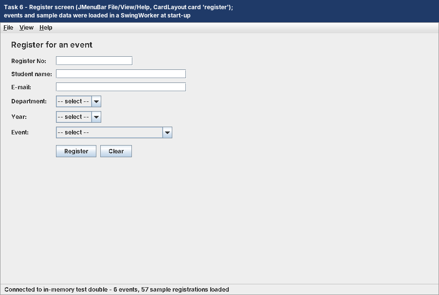{width=49%} 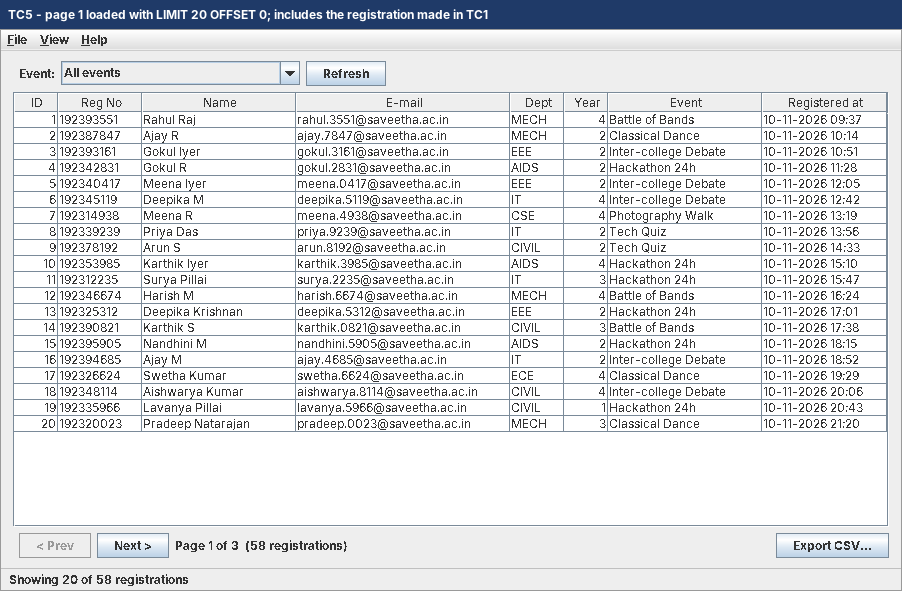{width=49%}

**Menu bar** (`JMenuBar`)

- **File**: Export CSV… (Ctrl+E), Exit.
- **View**: Register student (Ctrl+1), Registrations (Ctrl+2).
- **Help**: About.

The two screens are cards in a `CardLayout`, and a status bar sits at the bottom.

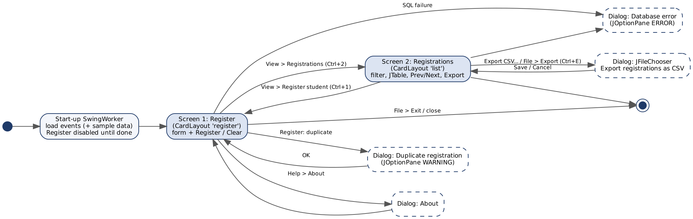{width=100%}

## Stage 3 – Critical design decisions

| Decision | Where | Why |
|---|---|---|
| **Input validation** | `RegistrationService.validate()`, called by the Register handler **on the EDT before any database work**, and called again inside `register()` | Fast, with no I/O, so the user gets instant feedback. Re-validating in the service means no caller can bypass the rules. |
| **Duplicate check** | (1) `RegistrationDao.exists()` (`SELECT 1 … WHERE reg_no = ? AND event_id = ?`) gives a friendly message. (2) The database **UNIQUE (reg_no, event_id)** key is the final guard. A `SQLIntegrityConstraintViolationException` becomes `DuplicateKeyException`, which becomes `DuplicateRegistrationException`. | The pre-check alone has a race: two desks can register the same student at the same moment. The constraint makes the rule hold under concurrency (T12). |
| **Capacity rule** | Service: `count(event) >= capacity` → `ValidationException` | Business rule, kept out of the UI |
| **Database access** | Only in `campus.dao` (JDBC `PreparedStatement`, try-with-resources, one connection per operation from `ConnectionFactory`) | No SQL in the UI or the service; every value is a bound parameter, so injection is impossible |
| **Keeping work off the EDT** | Every database call runs in a `SwingWorker`: start-up event loading, Register, page loads (filter, Prev/Next, Refresh) and export. `done()` updates the components on the EDT. Buttons are disabled and a "Loading…" bar is shown while busy. A **generation counter** discards results from an older, slower load when the user changes the filter quickly. | The window repaints and accepts input while queries run. **Measured** EDT delay during a load: 1 ms (TC5). |
| **Paging** | `LIMIT ? OFFSET ?` with page size 20, plus `COUNT(*)` for the page indicator; the table model holds only one page | Constant memory and fast first display (see the alternative) |

## Stage 4 – Classes and handlers

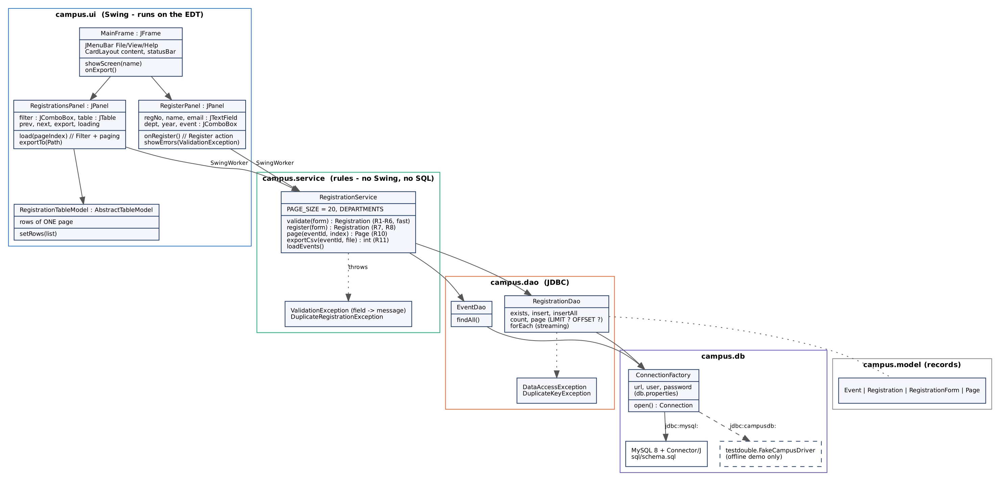{width=100%}

```text
ALGORITHM RegisterAction()                          // RegisterPanel.onRegister, on the EDT
    ClearHighlights()
    form <- RegistrationForm(regNo, name, email, dept, year, selectedEvent.id or null)
    TRY  service.validate(form)                      // R1-R6, no database
    CATCH ValidationException v:
        FOR EACH (field, message) IN v.fieldErrors DO Highlight(field); AddLine(message) END FOR
        Focus(first invalid field); RETURN
    registerButton.disable(); Show("Saving registration...")
    START SwingWorker
        doInBackground():                            // worker thread
            r <- service.validate(form)
            IF dao.exists(r.regNo, r.eventId) THEN THROW Duplicate
            IF dao.count(r.eventId) >= capacity(r.eventId) THEN THROW ValidationException("event full")
            TRY dao.insert(r)                        // PreparedStatement INSERT
            CATCH DuplicateKeyException: THROW Duplicate      // UNIQUE key - concurrent desks
            RETURN r
        done():                                      // EDT
            registerButton.enable()
            CASE outcome OF
                success:              Show green "Registered ..."; clear text fields; mark list stale
                Duplicate:            Highlight(regNo, event); WarningDialog(message)
                ValidationException:  show field errors (event full)
                DataAccessException:  ErrorDialog(message)
END

ALGORITHM FilterAction(pageIndex)                   // RegistrationsPanel.load: filter change, Prev, Next, Refresh
    eventId <- selected filter is an Event ? its id : null      // null = all events
    gen <- ++generation
    ShowLoadingBar(); disable Refresh, Export, Prev, Next
    START SwingWorker
        doInBackground():
            total <- dao.count(eventId)                         // SELECT COUNT(*) [WHERE event_id = ?]
            pages <- max(1, ceil(total / 20)); p <- clamp(pageIndex, 0, pages-1)
            rows  <- dao.page(eventId, 20, p*20)                // ... ORDER BY reg_id LIMIT ? OFFSET ?
            RETURN Page(rows, p, 20, total)
        done():
            IF gen ≠ generation THEN RETURN                     // a newer request superseded this one
            HideLoadingBar(); model.setRows(page.rows)
            pageLabel <- "Page " + (p+1) + " of " + pages + " (" + total + " registrations)"
            Prev.enabled <- p > 0;  Next.enabled <- p+1 < pages
END
```

## Stage 5 – Implementation and demonstration

The application runs from `Task06/src/campus/{model,db,dao,service,ui}` and starts with `campus.App`. The classes are listed in the class diagram. The UI uses `JFrame`, `JPanel`, `JTextField`, `JComboBox`, `JTable` (custom `AbstractTableModel`), `JMenuBar`, `CardLayout`, `JProgressBar`, `JOptionPane` and `JFileChooser`.

On first start the application loads `input/sample_registrations.csv` (57 rows) with a JDBC batch, but only if the table is empty.

**Service and JDBC tests** (`output/t6_service_tests.txt`, **18/18 pass**). These run against the real DAO SQL through the test-double driver:

- valid registration;
- duplicate on the same event; the same student on another event;
- each invalid field; all fields empty (6 messages);
- SQL text in the register number;
- event full;
- the database key blocking a duplicate that bypasses the service;
- paging (first, last, clamped) and filtering;
- export of a filter and of all rows.

**GUI demonstration** (real mouse and keyboard, `output/t6_gui_demo.txt`):

| TC | Interaction | Result | Screenshot |
|---|---|---|---|
| TC1 normal | 192311450, Keerthana S, keerthana.1450@…, CSE, 2, Inter-college Debate → Register | "✔ Registered 192311450 (Keerthana S) for Inter-college Debate." | `t6_2a_normal_filled.png`, `t6_2b_normal_registered.png` |
| TC2 invalid | `12AB`, `K3erthana`, `keerthana@`, nothing selected | 6 messages, the 6 fields outlined in red, no database call | `t6_3_invalid_input.png` |
| TC3 duplicate | A student from the sample data (192393551, Battle of Bands) registered again | Warning dialog "already registered…", nothing inserted | `t6_4_duplicate_dialog.png` |
| TC4 event full | New student → Photography Walk (capacity 3, full) | "Photography Walk is full (3 places)." | `t6_5_event_full.png` |
| TC5 load | View ▸ Registrations | "Loading…" bar while the worker runs; EDT delay 1 ms; then page 1 of 3 (58 registrations) | `t6_6_view_menu.png`, `t6_7_loading.png`, `t6_8_list_page1.png` |
| TC6 paging | Next | Page 2 of 3, first row ID 21 | `t6_9_list_page2.png` |
| TC7 filter | Event = Hackathon 24h | Page 1 of 1 (18 registrations) | `t6_10_filter_event.png` |
| TC8 export | File ▸ Export CSV…, chooser, Save | "Exported 18 registrations", `output/registrations_hackathon.csv` (19 lines incl. header) | `t6_11_export_chooser.png`, `t6_12_exported.png` |
| Exit | File ▸ Exit | Window disposed | – |

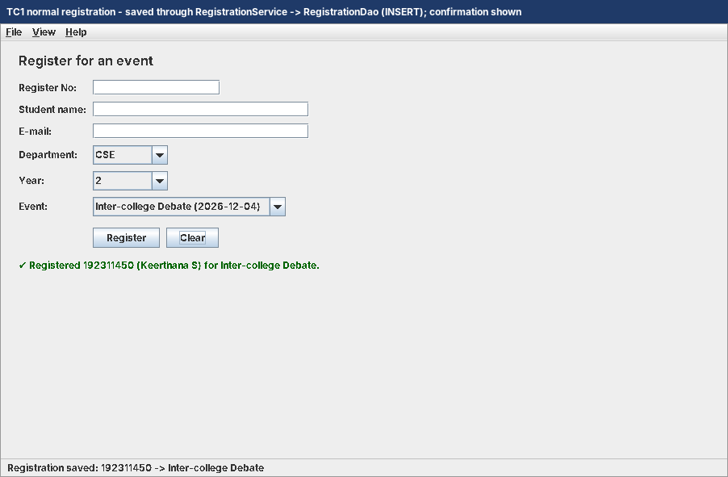{width=49%} 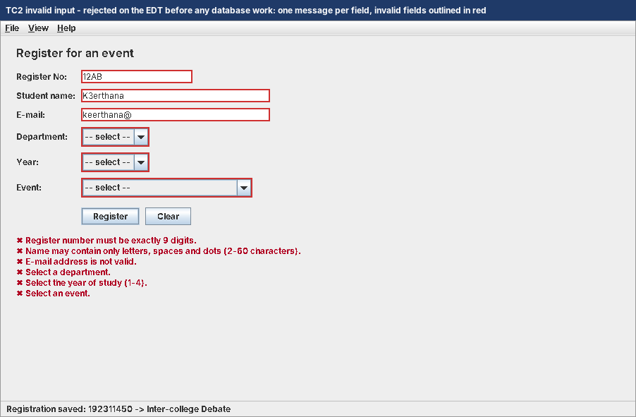{width=49%}

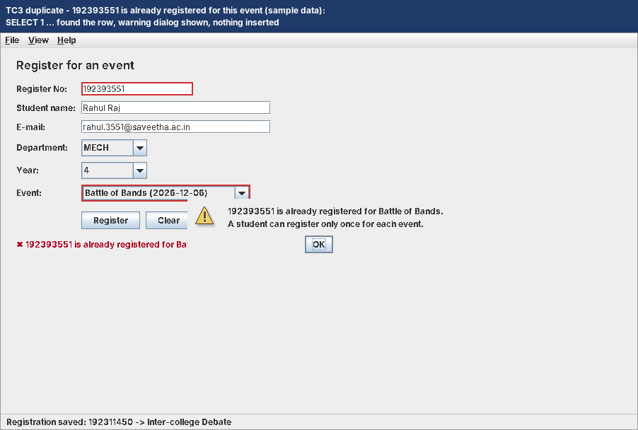{width=49%} 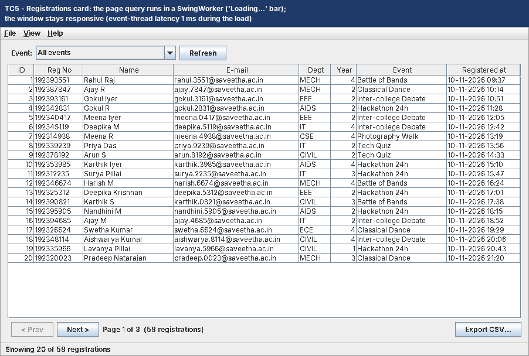{width=49%}

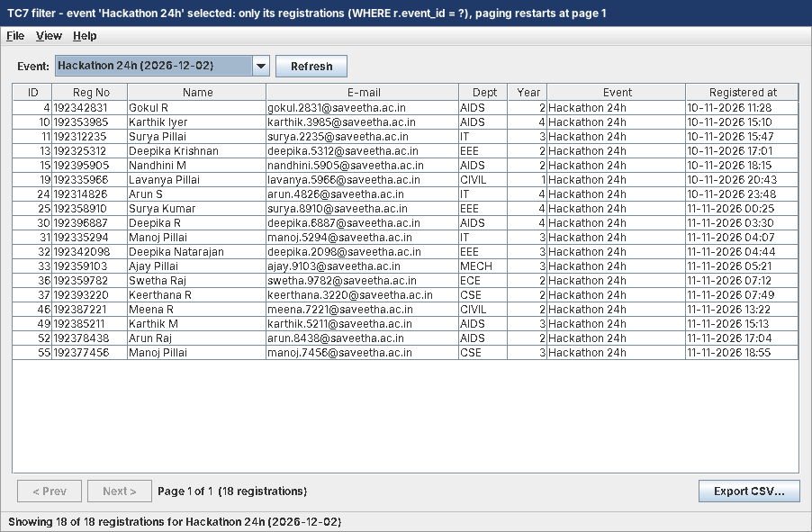{width=49%} 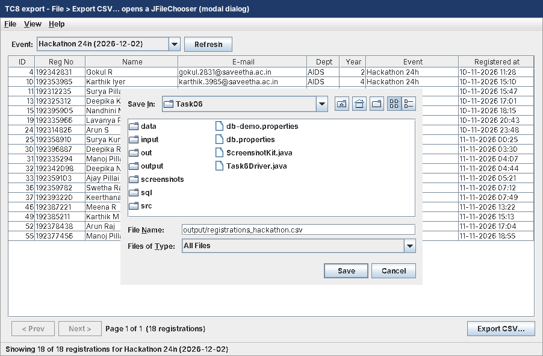{width=49%}

## Alternative concept – load all 100,000 rows at once vs one page at a time

**Alternative design:** run `SELECT … ORDER BY reg_id` without `LIMIT`, collect every row into a `List<Registration>`, and call `model.setRows(all)`. Done naively this happens in the event handler on the EDT; done carefully it happens in a SwingWorker. Prev/Next and the page label disappear (the table scrolls), and filtering is done either by re-querying or with a `TableRowSorter` in memory.

`PagingBenchmark` (`data/t6_paging_*.csv`, median of 5) inserts 100,000 registrations and is run twice:

- **in-memory** — the test-double driver with no transfer cost;
- **simulated network** — 1 ms per statement plus 5 µs per transferred row, about 200,000 rows/s, a typical Connector/J figure on a LAN.

| Approach (100,000 rows) | Load time in-memory | Load time simulated network | Longest EDT delay (network) | Retained heap | Rows in memory |
|---|---|---|---|---|---|
| All at once **on the EDT** | 55 ms | **535 ms** | **535 ms – window frozen** | 13.6 MB | 100,000 |
| All at once in a SwingWorker | 50 ms | 535 ms | 2 ms | 13.6 MB | 100,000 |
| Paged, first page (OFFSET 0) | 0.27 ms | **1.6 ms** | 0.2 ms | **2.6 KB** | 20 |
| Paged, OFFSET 50,000 | 1.1 ms | 2.5 ms | – | 2.6 KB | 20 |
| Paged, OFFSET 99,980 | 1.2 ms | 3.1 ms | – | 2.6 KB | 20 |
| `COUNT(*)` for the page label | 3.1 ms | 4.6 ms | – | – | – |

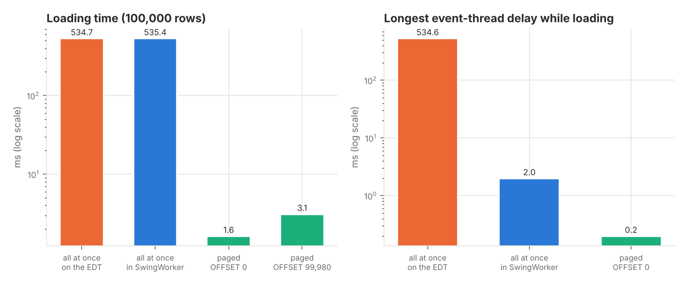{width=100%}

- **Time.** Loading everything costs **O(N)** to transfer and build N objects before the first row is visible: about 0.5 s here, and seconds on a slow network or with wider rows. A page costs **O(OFFSET + page size)**, because MySQL (and the test double) reads and discards the OFFSET rows. That is why the last page is about 2× the first. Keyset paging (`WHERE reg_id > lastId LIMIT 20`, using the index) would make every page O(log N + 20). `COUNT(*)` is O(N) on InnoDB but runs once per filter change.
- **Space.** All-at-once holds **O(N)** objects, about 140 B per registration, so 13.6 MB for 100,000 rows and proportionally more with more columns. Paging holds **O(page size)**, 2.6 KB for 20 rows. With `-Xmx` limits or many open windows, the O(N) approach risks `OutOfMemoryError`.
- **Responsiveness.** Run on the EDT, the all-at-once load **freezes the window for the entire load** (535 ms measured; seconds for a real remote server). In a SwingWorker the EDT stays free (2 ms), but the user still waits 0.5 s for the first rows, and the memory cost remains. Swapping the list in (`setRows`) takes under 1 ms either way, because JTable paints only the visible rows.
- **Verdict.** Paging in a SwingWorker gives the fastest first display, constant memory and a responsive window, so the application uses it. All-at-once is acceptable only for small tables (a few thousand rows), where client-side sorting and filtering without new queries is convenient. **It must never run on the EDT.**

\newpage

# Conclusion

| Task | Key result |
|---|---|
| 1 | 10 deficiencies diagnosed with evidence; the original froze the window for 2.8 s, while the redesign (FeeWindow → FeeService → interfaces, SwingWorker) kept event-thread latency at 0 ms; 12/12 service tests pass |
| 2 | Event table, containment tree, pseudocode and a real event trace (open → closing → dialog → closed); the Map lookup is 0.3–2 µs per change vs over 2 ms per database fetch |
| 3 | Nested Border/Flow layout: only the results area grows (520×212 → 1100×592) while buttons keep 55×23 and 41×23; null layout clips at small sizes |
| 4 | `mouseclicked` never overrides; `@Override` turns the mistake into a compile error; storing points and drawing them in `paint()` makes the dots survive minimise and restore |
| 5 | Four styles plus a changed requirement: lambda +4/−2 vs anonymous +7/−4; one shared `Action` gives one object for four triggers |
| 6 | Layered Swing–JDBC application: validation, a duplicate rule backed by a UNIQUE key, capacity, SwingWorker paging, filter and export; 18/18 tests and 8 GUI test cases; paging vs all-at-once: 1.6 ms vs 535 ms, 2.6 KB vs 13.6 MB |
